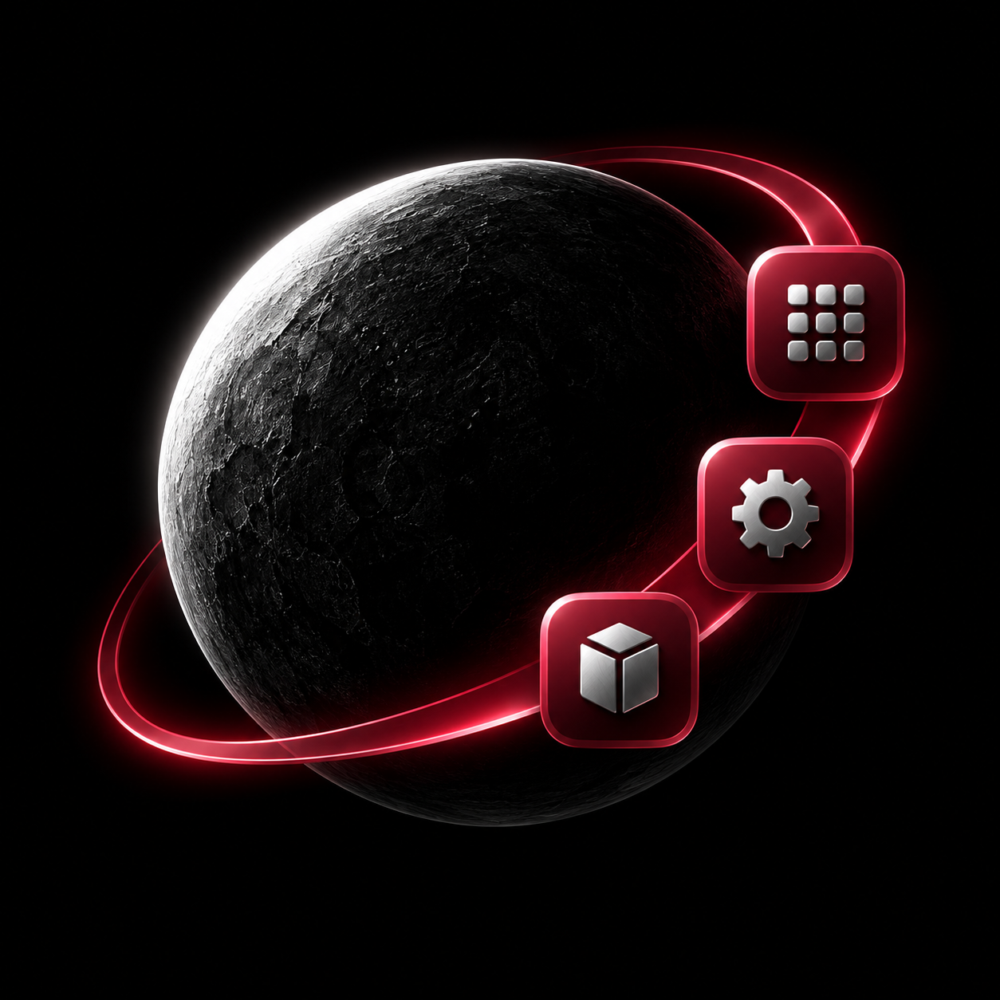

<!-- SPDX-License-Identifier: GPL-3.0-or-later OR CC-BY-SA-4.0 -->

  

<h1 align="center">Sphere</h1>

**Sphere (AppSphere) — a SysopBP fork of App Manager**

AppSphere is based on [App Manager by Muntashir Al-Islam and contributors](https://github.com/MuntashirAkon/AppManager). Original authorship, copyright notices, and applicable open-source licenses are retained. This independent fork is not endorsed by the original developers.

  <a href="docs/APPSPHERE_FEATURES.md">Sphere guide</a> ·
  <a href="CHANGELOG.md">What's New</a> ·
  <a href="https://github.com/SysopBP/AppManager/actions/workflows/appsphere-debug.yml">Debug APK builds</a> ·
  <a href="https://muntashirakon.github.io/AppManager">Upstream manual</a> ·
  <a href="https://github.com/SysopBP/AppManager/releases">Fork releases</a> ·
  <a href="https://t.me/AppManagerChannel">Telegram Channel</a>

---

## Sphere 4.2.2 (454)

Sphere combines App Manager's package-management tools with a refreshed dashboard,
AMOLED branding, customizable backgrounds and integrated installer controls.

### What's included

| Area | Sphere changes |
| --- | --- |
| AMOLED identity | Gold-globe launcher artwork with pure-black surroundings, adaptive/themed icons and matching Android/authentication splash screens. |
| Home dashboard | Device and backend summaries, memory/storage metrics, search, filters and tool shortcuts. |
| Floating navigation | Labelled Home, Apps, Installer, Running and Settings icons; hides when scrolling down and returns when scrolling up. |
| App pages | Compact app cards, refreshed detail headers/tabs and clearer metadata. Installed apps keep their own icons. |
| Settings | Grouped cards and single-pane/tablet layouts. |
| Backgrounds | Custom image picker, preview, wallpaper dimming from 0–100% and image brightness from 0–200%. |
| Theme engine | Material, True glass and Soft contrast presets; System, Violet, Blue, Mint and Amber accents; blur, opacity and reduced transparency. |
| Installer Control | Integrated InxLocker-derived installer/uninstaller selection, source-app rules, forced target activities and optional scoped routing. |
| Power and sessions | Battery-settings shortcuts, persistent-session control and requested versus detected privileged mode. |
| Startup repairs | Root/ADB startup, Binder checks/cleanup, private local-server extraction and the Android 17 navigation-drawable crash fix. |
| Release information | Current cumulative What's New popup, About version information and updated setup/build documentation. |

Soft contrast is the current name of the earlier MIUIX-inspired preset. The theme engine
uses native Android rendering. Dashboard refresh controls read current metrics.

### Download and install

1. Open [Sphere Android 17 Debug APK builds](https://github.com/SysopBP/AppManager/actions/workflows/appsphere-debug.yml).
2. Choose a **successful** run for the branch or commit you want. Pull-request runs are previews; choose **master** for merged changes.
3. Under **Artifacts**, download **Sphere-Android17-debug**. GitHub may require sign-in to download artifacts.
4. Extract the ZIP and install its APK. Allow installation from your browser or file manager if Android asks.
5. Open **Sphere** and choose the operating mode appropriate for your device.

A successful build confirms compilation and packaging; appearance, privileged operations,
OEM installer hooks and power use still need device testing. Published APK releases, when
available, appear on the [releases page](https://github.com/SysopBP/AppManager/releases).
Upstream App Manager distribution links below install the upstream app.

### Requirements and updates

| Item | Requirement |
| --- | --- |
| Minimum Android | Android 8 / API 26 |
| Target Android | Android 17 / API 37 |
| Release package | `io.github.sysopbp.sphere` |
| Debug package | `io.github.sysopbp.sphere.debug` |
| Updating an existing Sphere install | Same package ID and compatible signing key |
| Live glass blur | Android 12+ with supported hardware rendering |
| System-wide installer routing | Compatible modern libxposed/LSPosed service, module activation and scope |

Sphere's package IDs are separate from original App Manager installations. Export settings
and backups before migrating. Release and debug builds also use separate package IDs.
Do not uninstall an existing installation to resolve a signing conflict until you have
exported anything you need to keep.

### First-launch setup

- **Appearance:** open **Settings → Appearance → Theme engine** to choose a preset, accent,
  blur and surface opacity. Use reduced transparency for solid surfaces.
- **Wallpaper:** choose **Custom background**, enable it and adjust the dimming and image
  brightness in the preview. Image brightness does not change display brightness.
- **Installer:** open the **Installer** tab for APK selection and installer preferences.
  Ordinary local installer selection and system-wide interception have different setup requirements.
- **System-wide routing:** activate Sphere in compatible libxposed/LSPosed, configure scope
  and check the connected-service status. Root alone does not activate hooks. Hot reload
  requires API 102 capability; otherwise restart scoped processes. Experimental path-access
  and ColorOS controls are off by default.
- **Power:** open **Settings → Power and background activity** for persistent-session controls,
  Android battery settings and requested/detected backend status.

True glass falls back to solid surfaces with Battery Saver, reduced transparency, older
Android versions or unavailable hardware rendering. Wallpaper and glass support cover
the refreshed main/settings surfaces; inherited tool screens may use their existing layouts.
Privileged capabilities depend on the selected backend and device. This fork retains
App Manager's operating modes; it does not add TokenX's separate Root/System routing architecture.

### Guides

- [Full feature and setup guide](docs/APPSPHERE_FEATURES.md)
- [Installer Control and LSPosed setup](docs/appsphere-installer-control.md)
- [Implementation status and roadmap](docs/APPSPHERE_MIUIX_INXLOCKER_ROADMAP.md)
- [Complete fork changelog](CHANGELOG.md)
- [Build from source](BUILDING.rst)

## Inherited App Manager features

### General features
- Fully reproducible, copylefted libre software (GPLv3+)
- Material 3 with dynamic colours
- Display as much information as possible in the main page
- List activities, broadcast receivers, services, providers, app ops, permissions, signatures, shared libraries, etc. of an application
- Launch activities and services
- Create shortcuts of activities
- [Intercept activities](https://muntashirakon.github.io/AppManager/#sec:interceptor-page)
- Scan for trackers and libraries in apps and list (all or only) tracking classes (and their code dump)
- View/save the manifest of an app
- Display app usage, data usage (mobile and Wi-Fi), and app storage info (requires “Usage Access” permission)
- Install/uninstall APK files (including APKS, APKM and XAPK with OBB files)
- Share APK files
- Back up/restore APK files
- Batch operations
- Single-click operations
- Logcat viewer, manager and exporter
- [Profiles](https://muntashirakon.github.io/AppManager/#sec:profiles-page)
- Debloater
- Code editor
- File manager
- Simple terminal emulator
- Open an app in Aurora Store or in your favourite F-Droid client
- Sign APK files with custom signatures before installing
- Backup encryption: OpenPGP via OpenKeychain, RSA, ECC (hybrid encryption with AES) and AES.
- Track foreground UI components

### Root/ADB-only features

- Revoke runtime (AKA dangerous) and development permissions
- Change the mode of an app op
- Display/kill/force-stop running apps or processes
- Clear app data or app cache
- View/change net policy
- Control battery optimization
- Freeze/unfreeze apps

### Root-only features

- Block any activities, broadcast receivers, services, or providers of an app with native import/export as well as Watt and Blocker import support
- View/edit/delete shared preferences of any app
- Back up/restore apps with data, rules and extras (such as permissions, battery optimization, SSAID, etc.)
- View system configurations including blacklisted or whitelisted apps, permissions, etc.
- View/change SSAID.

…and many more! This single app combines the features of 5 or 6 apps any tech-savvy person needs!

### Upstream roadmap (not Sphere release features)
- Finder: Find app components, permissions etc. in all apps
- Basic APK editing
- Routine operations
- Enable/disable app actions such as launch on boot
- Crash monitor
- Systemless disabling/uninstalling of the system apps
- Import app list exported by App Manager
- More advance terminal emulator
- Database viewer and editor, etc.

## Translations

Help translate [the app strings](https://hosted.weblate.org/engage/app-manager/) and
[the docs](https://hosted.weblate.org/projects/app-manager/docs/) at Hosted Weblate.

## Upstream mirrors

[Codeberg](https://codeberg.org/muntashir/AppManager) ·
[GitLab](https://gitlab.com/muntashir/AppManager) ·
[Riseup](https://0xacab.org/muntashir/AppManager) ·
[sourcehut](https://git.sr.ht/~muntashir/AppManager)

## Upstream screenshots

These retained images show App Manager, not the current Sphere interface.

## Build Instructions
See [BUILDING.rst](BUILDING.rst)

## Contributing

See [CONTRIBUTING.rst](CONTRIBUTING.rst)

## Upstream donation and funding

As of September 2024, App Manager is not accepting any financial support until further notice. But
you may still be able to send gifts (e.g., gift cards, subscriptions, food and drink, flowers, or
even cash). Please contact the maintainer at muntashirakon [at] riseup [dot] net for further
assistance.

In addition, the maintainers and contributors of this project DO NOT consent to the creation, sale,
or promotion of tokens, cryptocurrencies, NFTs, or any other financial instruments that claim to
represent this project, its code, or its community. Any such attempts are unauthorized and not
affiliated with this project in any way.

## Credits and Libraries

A list of credits and libraries is available in **About**. App Manager: Muntashir Al-Islam
(@MuntashirAkon) and contributors. InxLocker: Chimioo and contributors, with integrated
GPL-3.0 source notices and licence retained. Sphere modifications: SysopBP.
